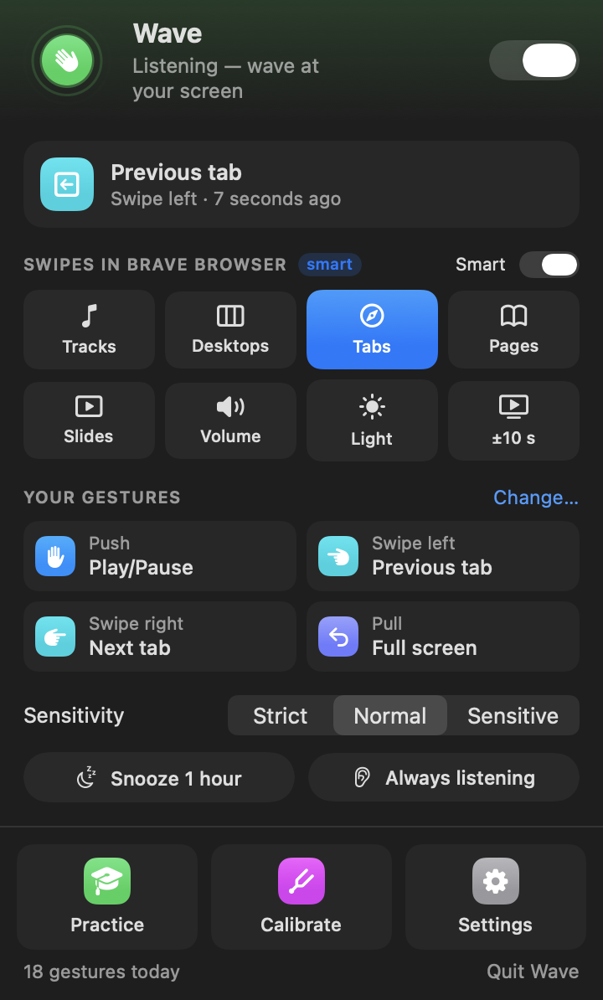
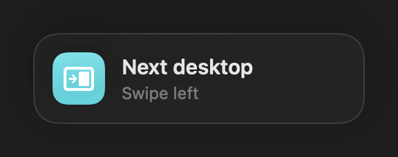
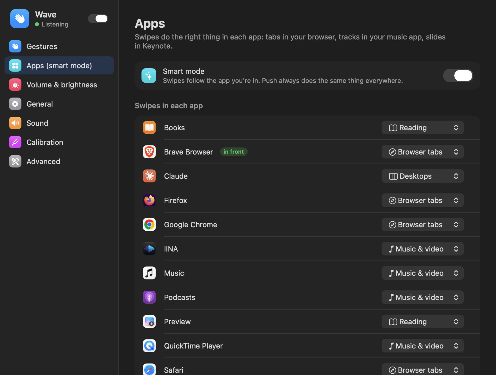
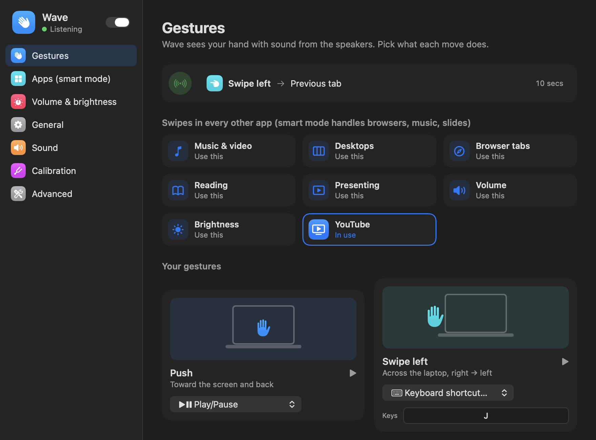
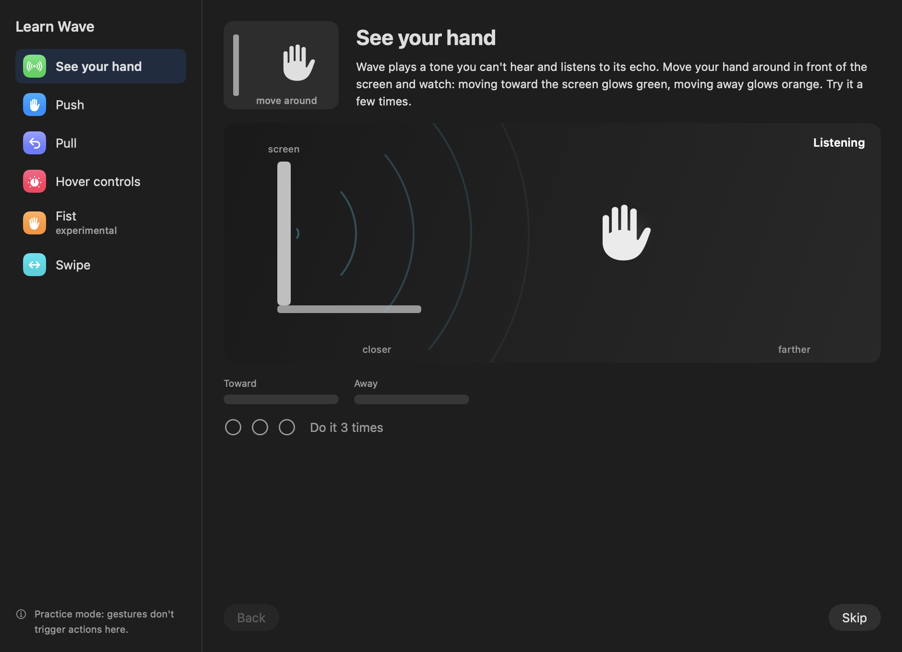
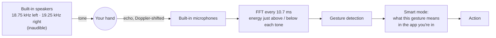

# Wave

**Control your Mac by moving your hand in the air, using only the speakers and microphones it already has.**

Wave turns a MacBook into a gesture device with no camera and no extra hardware. The built-in speakers play
an ultrasonic tone you can't hear; the built-in microphones listen to its echo off your hand; the Doppler shift
tells Wave how your hand moved. Push toward the screen to pause the video you're watching while you eat. Swipe
across the laptop to switch tabs in your browser, tracks in Spotify, slides in Keynote, or seconds on YouTube.

<p align="center">
  
  &nbsp;&nbsp;&nbsp;
  
</p>

- **Zero hardware.** Every MacBook already has the sensor: its speakers and microphones.
- **Private by design.** No camera. Audio is analysed in memory on the Mac and never saved or sent anywhere.
- **Knows what you're doing.** Smart mode makes the same swipe do the right thing in each app and on YouTube.
- **Built on measurements.** Tuned on real recordings of real hands, with a webcam-labelled test bench.

## What you can do

| Gesture | Motion | What it does |
|---|---|---|
| **Push** | Open hand toward the screen and back, about half a second | Play / Pause |
| **Swipe left / right** | A brisk pass across the laptop, 15–30 cm in front of the screen | Follows the app you're in (below); desktops everywhere else |
| **Pull** | From close up, flick your hand back toward you | Anything you map it to |
| **Volume, brightness** | Pick the Volume or Brightness swipe mode, then swipe right for more, left for less | |

Any gesture can trigger media keys, window and desktop actions (Mission Control, next desktop, minimize, full
screen), browser and document actions (tabs, back/forward, page up/down, zoom), slides, volume and brightness,
Spotlight, screenshots, any keyboard shortcut, or any shortcut from the Shortcuts app. Each one has a ▶ button
to try it without moving.

### Smart mode: the same swipe does the right thing everywhere

| You're in | Swipe left / right |
|---|---|
| Safari, Chrome, Brave, Arc, Firefox, Edge | Tab on the left / right |
| **YouTube** in any of those | Back / forward 10 s (recognised from the window title) |
| Spotify, Music, TV, Podcasts, VLC, IINA | Previous / next track |
| Keynote, PowerPoint | Previous / next slide |
| Preview, Books | Page down / up |
| Everything else | Previous / next desktop |

Every app and site can be changed, and any app added, in **Settings → Apps**. The menu always shows what swipes
do in the app you're using, and one tap changes it for that app.

<p align="center">
  
</p>

## The app

<p align="center">
  
</p>

- **Menu bar panel**: live status, the last gesture and what it did, swipe modes for the app in front, your
  gestures, sensitivity, snooze, and today's count.
- **On-screen confirmation** for every gesture, coloured by gesture, naming the action and the app.
- **Settings**: one page per topic. Each gesture is an animated card with its action and a try button. There
  are one-click setups, and the last detected gesture updates live so you can test right there.
- **Live tutorial** that shows your hand the way Wave senses it (toward = green, away = orange). It counts each
  gesture and explains why a try didn't count ("too slow", "didn't come back out", …).
- **Calibration** for your room and hand, and a **detection log** (text only, never audio). Every recognised
  or rejected gesture is listed with the reason, so a misfire can be explained afterwards.

<p align="center">
  
</p>

## How it works



A hand moving toward the laptop raises the pitch of the echo; moving away lowers it. Wave watches the energy
just above and below each tone, against a running baseline of the still room:

- **Push**: toward, then away, within 0.2–0.75 s. It reaches both tones in the same frame, and the hand comes back
  no faster than it went in.
- **Swipes**: each speaker plays its own tone. A hand crossing the laptop passes the left and right echo paths
  at different times (21–75 ms apart), which gives the direction. A push reaches both at once.
- **Rejecting everything else**: broadband sounds (taps, knocks, clicks) are louder away from the tones than a
  hand's Doppler can reach. Typing, clicking and scrolling pause detection for a moment, and so does a hand
  stopping right after a gesture. Push-like motions in the middle of a run of swipes are recognised as part of
  the swiping.
- **Fast**: a gesture is decided as soon as the hand's return is clearly under way: about 130 ms after the hand
  turns for a push, about 150 ms for a swipe.

The tone stays inaudible and at a constant acoustic level whatever the speaker volume, and Wave pauses itself
when it can't work: speakers muted, screen locked, lid closed. It uses about 2 % of one CPU core while
listening and nothing while idle.

## How it's tested

- **Hardware measurement first.** A frequency sweep of the MacBook Air M4's own speaker → microphone path
  showed it's usable only around 18.75–19.25 kHz, which set the tones ([docs/M0-FINDINGS.md](docs/M0-FINDINGS.md)).
- **Webcam-labelled sessions.** A guided session asks for each gesture in turn while it records the sonar audio,
  webcam snapshots and every detection. It then includes typing, everyday movement and taps, where nothing
  should fire. A report lists every hit, miss and false trigger with the webcam frames around it, and a replay
  harness runs the same audio through the current detector, so every change is checked against real hands
  before anyone tries it.
- **Latest labelled session**, replayed through the current detector: 45 correct detections and 2 false ones
  (hand movements during the fist and hover steps read as swipes). Nothing triggered during typing, everyday
  use or taps, and no swipe was mistaken for a push.
- **75 unit tests** on synthetic sonar scenes: a geometric hand model in front of two speakers, pushes, pulls,
  swipes in both directions, noise bursts, typing, fists.

## Privacy

- Audio is analysed **in memory, on your Mac**. It never leaves the Mac and is never saved, except debug
  recordings you start yourself.
- No camera. The guided test session's webcam snapshots are opt-in tooling, saved locally, and not part of the app.
- The **orange microphone dot** in the menu bar is on whenever Wave is listening: that's Wave hearing its own tone.
- The detection log holds gesture names, timings and levels as text; never sound.

## Get started

Requires a MacBook (built-in speakers and microphones), macOS 14 or later, and Xcode to build. Swift 6, Apple
frameworks only, no third-party dependencies.

```sh
make install     # build Wave.app, copy it to /Applications and start it
```

Wave lives in the menu bar. The first launch asks for **Microphone** access (to hear the echo) and
**Accessibility** (to press keys for you), checks the MacBook speakers aren't muted, and offers a hearing test
(if you can hear the tone, Wave moves to a higher one). Then open **Practice** in the menu and try a push.

## Status and what's next

Push and swipes are the solid core. Volume and brightness work reliably through swipe modes. Two features are
**experimental and off by default**:

- **Hovering for volume.** A hand held still and a hand that just paused look the same to sonar.
- **Fist.** Recognised from the faint sound of fingers meeting the palm; it only counts while the hand is held up.

Next:

- Learn each person's gestures from labelled samples (the app already records them as feature data, no audio).
- More sites in smart mode, and per-site actions.
- Developer ID signing and notarization for distribution (`scripts/release.sh`).

## Development

```sh
make app         # build Wave.app
make run         # build and launch without installing
make test        # unit tests
make session     # webcam-labelled test session (run from Terminal.app, which has microphone access)
python3 scripts/session_report.py   # report on the newest session: hits, misses, false triggers, frames
python3 scripts/session_replay.py   # replay that session through the current detector
make debug       # live spectrogram, detector traces and event log
make replay FILE=…/wave-….caf       # rerun the detector on a recording
make cpu         # CPU use of the running app
```

```
App/                    The menu bar app: menu, settings, smart mode, actions, on-screen confirmation, onboarding
Sources/WaveCore/       Audio (Core Audio devices, tone + capture), DSP (vDSP FFT), detection (features, push,
                        pull, two-tone fusion, hover, fist), engine, recording + replay, calibration
Sources/WaveUI/         Tutorial, live sonar view, debug views
Sources/wave-demo/      Webcam-labelled test session
Sources/wave-probe/     CLI: device report, sweeps, live detection, capture, replay
Sources/WaveRT/         C11 atomics for the real-time audio path
Tests/                  Unit tests (Swift Testing)
docs/                   Measurements and design notes
scripts/                Session report and replay, release, icon, CPU measurement
```

For distribution, change the bundle identifier (`local.wave.Wave`) to one you own and run
`scripts/release.sh --team TEAMID` (archive → sign with Developer ID → notarize → staple).
